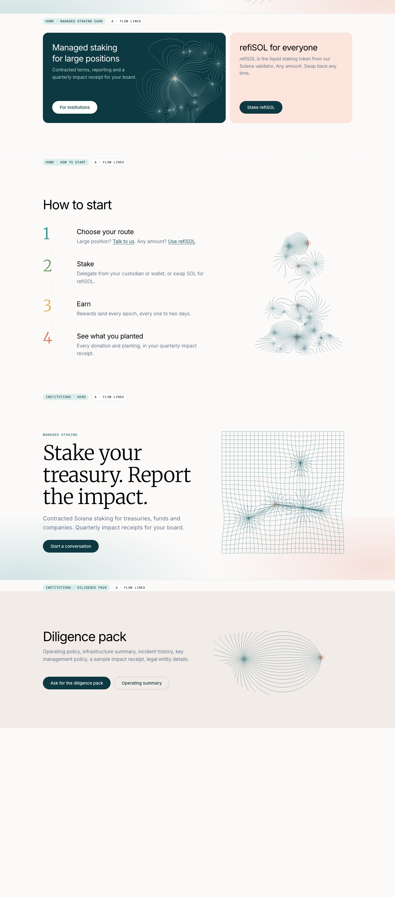
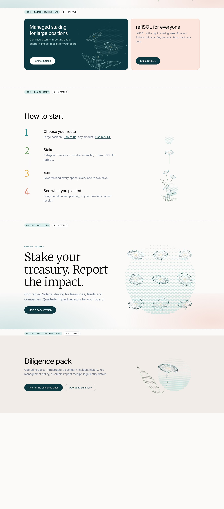
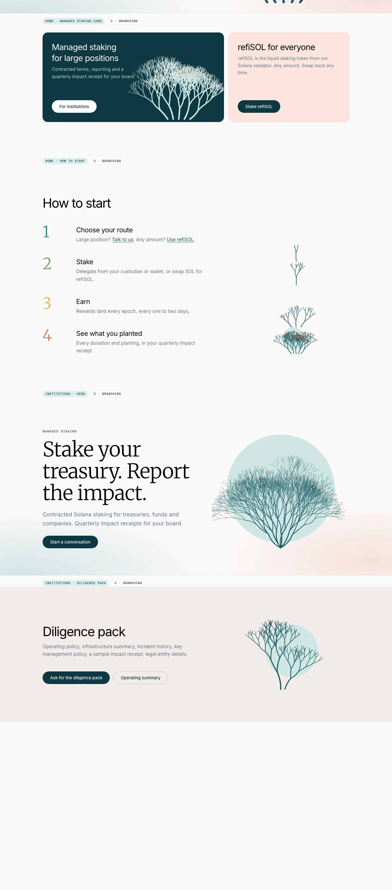

# Graphics exploration, round 1 (October 2026)

A reference record of the first round of graphics for the staking site, kept so we can come back to the styles we didn't pick.

**Decision:** we're taking **B · Stipple** forward, combined with elements of **A · Flow lines** (see round 2 in `prototypes/stipple/`). A and C are parked, not rejected. If either of us prefers one of them later, everything needed to bring it back is here.

## Why we did this

The site needed artwork with more creative edge in five places: the home hero, the "Managed staking" card, "How to start", the institutions hero and the diligence pack band. The references came from the mood board on the Notion card *Website v1: Push live*.

All three styles are drawn by code (`prototypes/graphics/graphics.js`), not image files. That keeps them sharp at any size and lets them be regenerated with a new seed, and later they could be driven by real numbers from `claims.json`.

## Try it live

Run the site locally (`python3 -m http.server 8765`) and open:

- All three styles stacked per section: http://localhost:8765/prototypes/graphics/
- A single style: add `?style=A`, `?style=B` or `?style=C`
- Other options: `&palette=ink` or `&palette=blue` for the colour previews, `&seed=123` for a different variation

## The three styles

| | Style | Idea | Mood board reference |
|---|---|---|---|
| **A** | Flow lines | Field lines flow from many sources into one node, the validator. It reads as nature and as a network at once. | Blue field-line drawing |
| **B** | Stipple ✅ | Polyps and fronds drawn in dots, like a halftone print. Each dot could stand for corals planted. | Blue dotted flowers, Kaiporah's PR #15 |
| **C** | Branching | Staghorn-style coral grown by a branching rule, over a flat disc. The most literal coral, and the calmest. | Branching trees on beige |

How each style adapts per section:

| Section | A · Flow lines | B · Stipple | C · Branching |
|---|---|---|---|
| Home hero | Bloom of field lines into a core node | Three polyps, fronds, halftone disc | Coral thicket over a disc |
| Managed staking card (dark) | Light field lines | Light polyp cluster | Light coral |
| How to start | Bloom grows from 1 to 12 nodes | Seed → polyp → cluster | Coral grows 1 → 6 levels |
| Institutions hero | Grid pulled towards nodes | 3×3 specimen plate | Sea fan |
| Diligence pack | Two-node dipole | Single polyp with frond | Coral sprig |

## Style A · Flow lines

## Style B · Stipple (chosen)

## Style C · Branching

## Notes for whoever picks this up

- Colours shown are the current site palette. Colours were deliberately left for a later pass: the staking site may be more colourful than refihub.io, since it's a different business unit focused on coral conservation and nature.
- Shuffle/seed: the same seed always draws the same picture, so any variation we like can be locked in.
- The real-life partner photos on the mood board are for a separate gallery section and were not part of this exploration.
